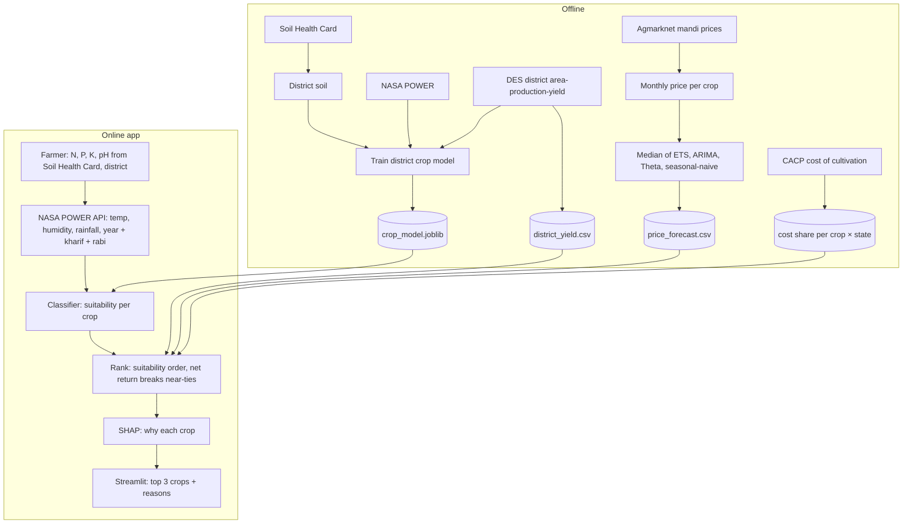

# Architecture

Oct 29, 2026. Scope of what we build, where each piece comes from, and where it ends up.

## Two halves

- **Offline (we run once, before the demo):** clean the datasets, train the models, save them.
- **Online (the app, every time a farmer asks):** take inputs, fetch weather, predict, rank, explain.

## Components

| # | Component | Comes from | What it does | Goes to |
| --- | --- | --- | --- | --- |
| 1 | Crop model (district × season) | Soil Health Card district soil + NASA POWER weather + DES crop area by season (since Nov 4) | 12 inputs (card N, P, K, pH; year, kharif and rabi weather; season from the sowing month: Jun–Sep kharif, Oct–Jan rabi, Feb–May summer) → share of that season's farmland that similar districts put under each of 27 crops. Random Forest, one row per district × season × crop weighted by area share; year-round crops (sugarcane, coconut, fruit) split equally across seasons; crops grown that season in < 5% of districts are not offered (`notebooks/11_season_model.ipynb`). The year-round model (notebook 09) is kept as `models/annual_crop_model.joblib`, the Kaggle model as `models/kaggle_crop_model.joblib` | `models/crop_model.joblib` |
| 2 | Price forecast | Agmarknet mandi prices (`mandi_prices()`) | Median of AutoETS, AutoARIMA, AutoTheta and seasonal-naive per crop × state and all-India, 12 months ahead, with backtest MAPE (`notebooks/06_price_model_tests.ipynb`, section 4) | `data/processed/price_forecast.csv` |
| 3 | District yield | DES district APY (`district_yield()`) | Mean yield of each district's last 5 reported years; series that stopped before 2010-11 dropped; rice converted from milled rice to paddy (÷ 0.67) to match paddy prices | `data/processed/district_yield.csv` |
| 4 | Weather lookup | NASA POWER API (live) | District → temperature, humidity, rainfall for the year, kharif (Jun–Sep) and rabi (Nov–Feb) | Called by the app |
| 5 | District coordinates | Median lat/lon of each district's APMC markets (`district_coords()`) | LGD district code → latitude/longitude for NASA POWER | `data/processed/district_coords.csv` |
| 6 | Ranker | Outputs of 1, 2, 3 + CACP cost shares (`cost_shares()`) | Top 3 with suitability ≥ 5%, in suitability order; crops ≥ 0.8 × the top crop's suitability are ordered by net return = yield × price × (1 − cost share). Price is MSP 2026-27 for paddy and wheat in Punjab and Haryana (procurement states, thin mandi data) | `project/recommend.py` |
| 7 | Explainer | SHAP on the forest (model 1) | Which inputs pushed each crop up or down; adds up to the suitability shown | App display |
| 8 | Demo app | All of the above | Soil card + district + sowing month form (or "no card": the district's Soil Health Card average, else the mean of the 3 nearest districts with ≥ 100 tests, `recommend.area_soil`) → weather, ranked crops with net return, SHAP plot per crop (built Nov 4; agent chat still to add) | `project/app.py` |
| 9 | Consultant agent | Qwen3-4B via Ollama, calling 1–7 as tools | Chat in the farmer's language, remembers the farm, explains results. Never changes the ranking. See `docs/agent.md` | `project/agent.py` |

The research side adds one more piece: the **real-world check**. It runs DES districts
(with Soil Health Card soil averages + NASA POWER weather) through the classifier and compares
the picks with what each district actually grows. Its tables go to `research/`. It is not part of the app.
Result (Nov 3, notebook 08): no better than random crops; see `research/notes/2026-11-03_real_world_check.md`.

## Planned code (in `project/`)

| File | Job |
| --- | --- |
| `data.py` | Load and clean every dataset |
| `recommend.py` | The online pipeline: weather → predict → rank → explain |
| `agent.py` | Consultant agent: tools, loop, farm-profile memory |
| `app.py` | Streamlit front end, calls `recommend.py` and `agent.py` |

Training happens in notebooks (crop model: 11, price forecast: 06), which save what the app reads.
Data lives in a top-level `data/` (`raw/`, `processed/`), kept out of git.
Workshop notebooks are trimmed copies of the notebooks in `notebooks/`.

## Open design questions

1. **Matching weather to Kaggle.** Kaggle doesn't say what period its temperature, humidity and rainfall
   cover. We must pick one NASA POWER aggregation (e.g. growing-season average temperature and total rainfall)
   and check its values land in Kaggle's ranges.
   **Answered Oct 29:** use the 10-year mean temperature and humidity and the mean monthly rainfall. Humidity doesn't match
   real weather at all, so phase 2 tests the model with and without it. See `build-log.md`.
   **Answered Nov 3:** dropping humidity costs 1.1 points of accuracy and no top-3 accuracy, so the app model leaves it out.
2. **Crop coverage.** Kaggle has 22 crops, including fruits (mango, apple, grapes…). The yield data mostly
   covers field crops. Crops without yield or price data get ranked by suitability only, flagged in the app.
   **Prices answered Oct 30:** 21 of 22 crops have mandi prices, fruits included. Only kidney beans has none.
3. **Crop name mapping.** The three sources name crops differently (e.g. "pigeonpeas" vs "Arhar/Tur").
   One small mapping table fixes it. Prices: `APMC_NAMES` in `project/data.py`.
4. **Ranking by revenue favours fruit** (found Nov 3, `notebooks/04_ranking.ipynb`). Fruit grosses ~10× field crops per
   hectare, so a weakly suitable fruit beats a well-suited field crop. Options: add cultivation cost (CACP), rank by
   suitability and show revenue alongside, or only compare crops of the same type.
   **Tested Nov 3** (`research/notes/2026-11-03_model_research.md`): recommended rule is suitability order with net
   return breaking near-ties (suitability ≥ 0.8 × top).
   **Applied Nov 3** (user approved). Fruit has no CACP cost, so it gets the median field-crop share, flagged "assumed"
   in the table; orchard set-up years are still not counted.
